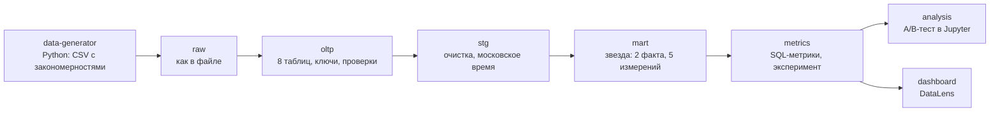
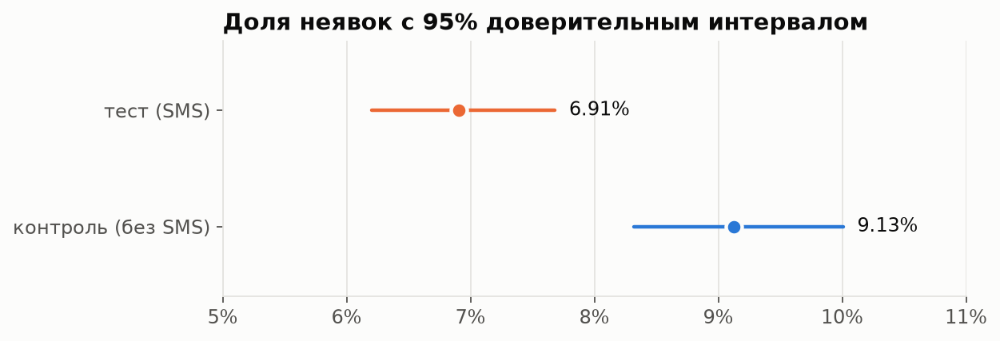
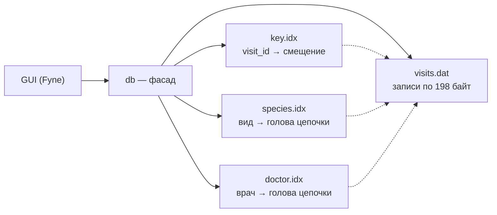
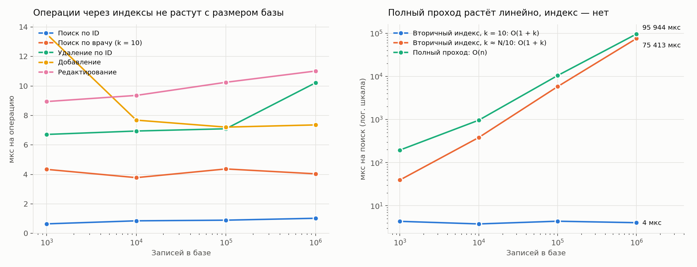

# VetCare

[](https://github.com/sseusti/VetCare/actions/workflows/ci.yml)


**Информационная система ветеринарной клиники — от модели данных до аналитики.**

Проект растёт по слоям: сначала модель предметной области, затем собственный движок хранения с индексами на диске, затем аналитическое хранилище, метрики, A/B-тест и дашборд. Каждый слой самостоятельный и лежит в своей папке.

| Слой | Что это | Статус |
| --- | --- | --- |
| [Модель данных](docs/lab1) | предметная область, UML- и ER-диаграммы: владельцы, животные, медкарты, приёмы, врачи, оплаты | ✅ готово |
| [Движок хранения](storage-engine) | файловая СУБД на Go: хеш-индексы на диске, O(1) по ключу, вторичные индексы, GUI на Fyne | ✅ готово |
| [Аналитика](#аналитика) | генератор данных, PostgreSQL, витрины «звезда», SQL-метрики, [A/B-тест](analysis), [дашборд](dashboard) | ✅ готово, дашборд собирается в DataLens |

---

## Аналитика

Двухлетняя история клиники — 4,5 тыс. клиентов, 6 тыс. животных, 28 тыс. приёмов — проходит путь от сырых CSV до решения для бизнеса.



На каждом слое — автоматические проверки качества (54 штуки: сходимость выручки, полнота фактов, корректность сплита); все они, тесты и выполнение ноутбука идут в CI на каждый push.

### A/B-тест: SMS-напоминания снижают неявки на 24%

Клиника 8 месяцев тестировала SMS-напоминание накануне приёма на 9,7 тыс. записей. Неявки снизились **с 9,1% до 6,9%** (95% ДИ эффекта [−34%; −13%], p = 0,0001) — это около 25 сохранённых приёмов в месяц, напоминания окупаются в 6–12 раз.



Что проверено в [ноутбуке](analysis/ab_sms_reminders.ipynb): корректность сплита (SRM) и баланс групп; **ловушка наивного сравнения, которое занижает эффект на треть**; кластерный бутстрап по клиентам; CUPED; мощность и MDE; A/A-тесты и цена подглядывания (48% ложных срабатываний вместо ~5%); сегменты с поправкой Холма; барьерные метрики; перевод эффекта в деньги. Подробнее — [analysis/README.md](analysis).

### Что видно в данных

| Вопрос | Ответ | Где |
| --- | --- | --- |
| Растёт ли клиника? | выручка за последний год на 5–44% выше того же месяца годом раньше; пик — май–июнь, провал — февраль | [`01_revenue.sql`](dwh/metrics/01_revenue.sql) |
| Что приносит деньги? | хирургия — 7% приёмов, но 34% выручки; оба хирурга загружены на 35–42% выше медианы | [`02_doctors.sql`](dwh/metrics/02_doctors.sql), [`04_utilization.sql`](dwh/metrics/04_utilization.sql) |
| Когда не приходят? | в понедельник 13,7% неявок против 7,5–8,7%; при записи за 15+ дней — 15% против 7,4% накануне | [`03_no_show.sql`](dwh/metrics/03_no_show.sql) |
| Возвращаются ли клиенты? | в следующем месяце — 29% новых клиентов, через год — 20%; за полгода хотя бы раз возвращаются 79% | [`05_retention.sql`](dwh/metrics/05_retention.sql) |
| Сколько приносит клиент? | LTV — 3,9 тыс. ₽ в первый месяц, 9,4 тыс. ₽ за полгода, 14 тыс. ₽ за год | [`06_ltv.sql`](dwh/metrics/06_ltv.sql) |
| Кого мы теряем? | 17% клиентов ушли, 14% засыпают; у владельцев 3+ животных отток в 5 раз ниже, чем у владельцев одного | [`07_churn.sql`](dwh/metrics/07_churn.sql) |

Данные синтетические, но с заложенными закономерностями ([data-generator](data-generator)): сезонность, отток по лояльности, факторы неявок, эффект SMS. Анализ их восстанавливает — так проверяется и методика.

### Быстрый старт

Нужны Docker, Python 3.12+ и `make`.

```bash
cp .env.example .env                                   # пароль базы
cd data-generator && python3 -m venv .venv && .venv/bin/pip install -r requirements.txt && cd ..
make all             # база, данные, витрины, метрики и все проверки — около минуты
make psql            # SELECT * FROM metrics.revenue_monthly;
make analysis-venv   # один раз — окружение для ноутбука
make ab              # пересчитать A/B-анализ
make export          # CSV для дашборда в DataLens
```

| Папка | Что внутри |
| --- | --- |
| [`data-generator`](data-generator) | генератор данных клиники с заложенными закономерностями, тесты |
| [`dwh`](dwh) | SQL: схема, загрузка, витрины, [метрики](dwh/metrics), проверки качества |
| [`analysis`](analysis) | A/B-тест: статистика своими руками с тестами и ноутбук с выводами |
| [`dashboard`](dashboard) | как собрать дашборд в DataLens: датасеты, формулы, чарты |

### Чек-лист

- [x] генератор реалистичных данных клиники за 2 года: сезонность, неявки, отток, A/B-эксперимент
- [x] PostgreSQL: сырые данные → рабочая схема → staging → витрины по схеме «звезда», проверки качества в CI
- [x] метрики на SQL: выручка и средний чек, загрузка врачей, неявки, когорты и удержание, LTV, отток
- [x] A/B-анализ эффекта SMS-напоминаний
- [x] данные и инструкция для дашборда — [dashboard](dashboard)
- [ ] публичная ссылка на дашборд в DataLens

---

## Движок хранения

Однотабличная база приёмов клиники, в которой **все операции идут напрямую по файлам** — чтение и запись по смещению, без загрузки таблицы в память. Индексы тоже живут на диске.

### Ключевые результаты

- **O(1)** на добавление, поиск, редактирование и удаление по ключу — собственная хеш-таблица на диске с открытой адресацией.
- **O(1 + k)** на поиск и удаление по виду животного и врачу — двусвязные цепочки прямо внутри записей.
- **~1 мкс** на поиск по ключу в базе из 1 000 000 записей; время не растёт с объёмом.
- **В 24 000 раз** быстрее полного прохода при поиске по индексированному полю на миллионе записей.
- **76% покрытия** тестами, включая рандомизированные тесты против эталонной модели и проверку целостности индексов.

### Возможности

- создание, открытие, сохранение, очистка и удаление базы;
- добавление с проверкой уникальности ключа, редактирование, удаление;
- поиск и удаление по ключу и по неключевым полям (все совпадения);
- резервное копирование и восстановление с проверкой копии;
- экспорт в Excel (.xlsx);
- в строке статуса — время каждой операции и способ поиска: индекс или полный проход.

### Как это устроено

База — это папка из четырёх файлов: записи и три хеш-индекса.



**Записи фиксированной длины.** Каждый приём занимает ровно 198 байт, поэтому адрес записи вычисляется формулой `64 + i × 198`, а правка идёт на месте. Удалённые слоты собираются в список свободных внутри того же файла и переиспользуются — файл никогда не сдвигается.

**Хеш-индекс на диске.** FNV-1a, линейное пробирование, tombstone при удалении, перестройка при заполнении выше 70% через временный файл и атомарный `rename` — сбой посередине оставляет либо старую, либо новую таблицу.

**Вторичные индексы без отдельных списков.** Все записи с одним видом (врачом) связаны двусвязным списком через ссылки внутри самих записей, индекс хранит только голову. Вставка в голову и удаление из середины — O(1).

```
species.idx: "Кошка" → [приём 5] ⇄ [приём 3] ⇄ [приём 1] → ∅
```

### Производительность

Время одной операции при росте базы с 1 000 до 1 000 000 записей:

| Операция | 1 тыс. | 10 тыс. | 100 тыс. | 1 млн | Сложность |
| --- | ---: | ---: | ---: | ---: | --- |
| Поиск по ID | 0,6 мкс | 0,9 мкс | 0,9 мкс | 1,0 мкс | O(1) |
| Добавление | 13,5 мкс | 7,7 мкс | 7,2 мкс | 7,4 мкс | O(1) |
| Удаление по ID | 6,7 мкс | 6,9 мкс | 7,1 мкс | 10,2 мкс | O(1) |
| Поиск по врачу, 10 результатов | 4,3 мкс | 3,8 мкс | 4,4 мкс | 4,0 мкс | O(1 + k) |
| Поиск по кличке, полный проход | 0,2 мс | 1,0 мс | 10,4 мс | 95,9 мс | O(n) |



Методика, окружение и разбор выбросов — в [отчёте](docs/lab2/report.md#6-временная-статистика).

### Быстрый старт

Нужны Go 1.24+ и на macOS — Xcode Command Line Tools (`xcode-select --install`).

```bash
git clone https://github.com/sseusti/VetCare.git
cd VetCare/storage-engine

go run ./cmd/vetdb          # запустить приложение
go test ./internal/...      # тесты
go run ./cmd/bench          # замеры на 1k–1M записей
```

В приложении: **Файл → Создать базу**, затем **Добавить**. Для поиска выберите поле, введите значение и нажмите **Найти** — в строке статуса будет видно, сколько занял поиск и шёл ли он по индексу.

### Структура

```
storage-engine/
├── cmd/
│   ├── vetdb/        приложение
│   └── bench/        замеры производительности
└── internal/
    ├── record/       модель приёма, формат записи, валидация
    ├── hashfile/     хеш-таблица на диске
    ├── heap/         файл записей и список свободных слотов
    ├── db/           фасад: CRUD, вторичные индексы, резервные копии
    ├── export/       выгрузка в .xlsx
    └── ui/           интерфейс на Fyne
```

Зависимости идут строго сверху вниз: интерфейс знает только `db`, а `heap` и `hashfile` не знают друг о друге.

### Качество

- **Рандомизированные тесты:** тысячи случайных операций одновременно над базой и над обычной структурой в памяти, со сверкой после каждой серии и переоткрытием файлов.
- **Проверка целостности:** после операций проверяется, что индекс ключа указывает на верные записи, а каждая цепочка — корректный двусвязный список.
- **Защита от повреждений:** битые, обрезанные и несогласованные файлы распознаются при открытии; восстановление из копии не трогает текущую базу, пока копия не проверена.
- **CI:** gofmt, go vet, сборка и тесты с `-race` на каждый push, порог покрытия 60%; те же проверки локально через `pre-commit`.

---

## Модель данных

Предметная область — ветклиника: владелец может иметь несколько животных, у каждого животного — медицинская карта и история приёмов, приём проводит врач и оплачивается отдельно. Полное описание — в [docs/lab1](docs/lab1/README.md).


## Стек

**Аналитика:** SQL (оконные функции, CTE) · PostgreSQL · Python · pandas · SciPy · Jupyter · matplotlib · DataLens

**Разработка:** Go · Fyne · Docker · GitHub Actions · pre-commit · pytest

## Автор

**Степан Кельзин** — студент НИУ ВШЭ (Нижний Новгород), «Компьютерные науки и технологии» · [GitHub](https://github.com/sseusti)
