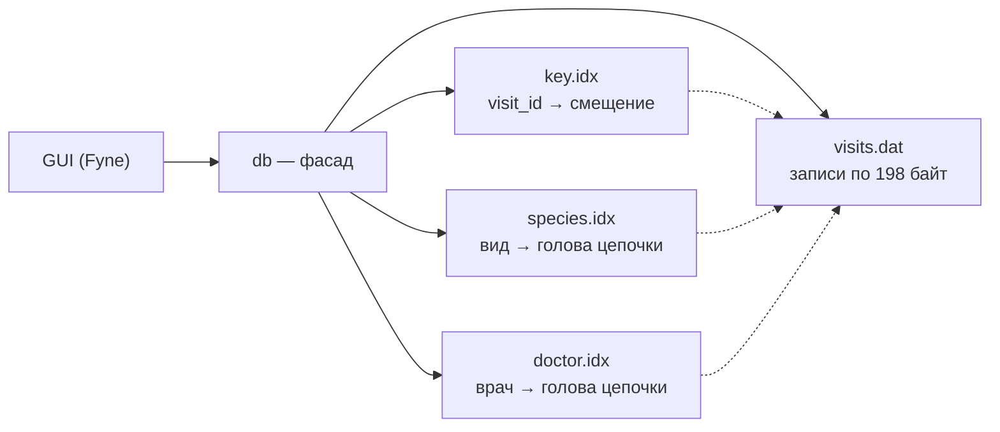

# VetCare

[](https://github.com/sseusti/VetCare/actions/workflows/ci.yml)


**Информационная система ветеринарной клиники — от модели данных до аналитики.**

Проект растёт по слоям: сначала модель предметной области, затем собственный движок хранения с индексами на диске, затем аналитическое хранилище и дашборды. Каждый слой самостоятельный и лежит в своей папке.

| Слой | Что это | Статус |
| --- | --- | --- |
| [Модель данных](docs/lab1) | предметная область, UML- и ER-диаграммы: владельцы, животные, медкарты, приёмы, врачи, оплаты | ✅ готово |
| [Движок хранения](storage-engine) | файловая СУБД на Go: хеш-индексы на диске, O(1) по ключу, вторичные индексы, GUI на Fyne | ✅ готово |
| Аналитика | генератор данных, PostgreSQL, витрины, SQL-метрики, A/B-анализ, дашборд в DataLens | 🛠 в планах |

---

## Движок хранения

Однотабличная база приёмов клиники, в которой **все операции идут напрямую по файлам** — чтение и запись по смещению, без загрузки таблицы в память. Индексы тоже живут на диске.

### Ключевые результаты

- **O(1)** на добавление, поиск, редактирование и удаление по ключу — собственная хеш-таблица на диске с открытой адресацией.
- **O(1 + k)** на поиск и удаление по виду животного и врачу — двусвязные цепочки прямо внутри записей.
- **~1 мкс** на поиск по ключу в базе из 1 000 000 записей; время не растёт с объёмом.
- **В 24 000 раз** быстрее полного прохода при поиске по индексированному полю на миллионе записей.
- **76% покрытия** тестами, включая рандомизированные тесты против эталонной модели и проверку целостности индексов.

### Возможности

- создание, открытие, сохранение, очистка и удаление базы;
- добавление с проверкой уникальности ключа, редактирование, удаление;
- поиск и удаление по ключу и по неключевым полям (все совпадения);
- резервное копирование и восстановление с проверкой копии;
- экспорт в Excel (.xlsx);
- в строке статуса — время каждой операции и способ поиска: индекс или полный проход.

### Как это устроено

База — это папка из четырёх файлов: записи и три хеш-индекса.



**Записи фиксированной длины.** Каждый приём занимает ровно 198 байт, поэтому адрес записи вычисляется формулой `64 + i × 198`, а правка идёт на месте. Удалённые слоты собираются в список свободных внутри того же файла и переиспользуются — файл никогда не сдвигается.

**Хеш-индекс на диске.** FNV-1a, линейное пробирование, tombstone при удалении, перестройка при заполнении выше 70% через временный файл и атомарный `rename` — сбой посередине оставляет либо старую, либо новую таблицу.

**Вторичные индексы без отдельных списков.** Все записи с одним видом (врачом) связаны двусвязным списком через ссылки внутри самих записей, индекс хранит только голову. Вставка в голову и удаление из середины — O(1).

```
species.idx: "Кошка" → [приём 5] ⇄ [приём 3] ⇄ [приём 1] → ∅
```

### Производительность

Время одной операции при росте базы с 1 000 до 1 000 000 записей:

| Операция | 1 тыс. | 10 тыс. | 100 тыс. | 1 млн | Сложность |
| --- | ---: | ---: | ---: | ---: | --- |
| Поиск по ID | 0,6 мкс | 0,9 мкс | 0,9 мкс | 1,0 мкс | O(1) |
| Добавление | 13,5 мкс | 7,7 мкс | 7,2 мкс | 7,4 мкс | O(1) |
| Удаление по ID | 6,7 мкс | 6,9 мкс | 7,1 мкс | 10,2 мкс | O(1) |
| Поиск по врачу, 10 результатов | 4,3 мкс | 3,8 мкс | 4,4 мкс | 4,0 мкс | O(1 + k) |
| Поиск по кличке, полный проход | 0,2 мс | 1,0 мс | 10,4 мс | 95,9 мс | O(n) |


Методика, окружение и разбор выбросов — в [отчёте](docs/lab2/report.md#6-временная-статистика).

### Быстрый старт

Нужны Go 1.24+ и на macOS — Xcode Command Line Tools (`xcode-select --install`).

```bash
git clone https://github.com/sseusti/VetCare.git
cd VetCare/storage-engine

go run ./cmd/vetdb          # запустить приложение
go test ./internal/...      # тесты
go run ./cmd/bench          # замеры на 1k–1M записей
```

В приложении: **Файл → Создать базу**, затем **Добавить**. Для поиска выберите поле, введите значение и нажмите **Найти** — в строке статуса будет видно, сколько занял поиск и шёл ли он по индексу.

### Структура

```
storage-engine/
├── cmd/
│   ├── vetdb/        приложение
│   └── bench/        замеры производительности
└── internal/
    ├── record/       модель приёма, формат записи, валидация
    ├── hashfile/     хеш-таблица на диске
    ├── heap/         файл записей и список свободных слотов
    ├── db/           фасад: CRUD, вторичные индексы, резервные копии
    ├── export/       выгрузка в .xlsx
    └── ui/           интерфейс на Fyne
```

Зависимости идут строго сверху вниз: интерфейс знает только `db`, а `heap` и `hashfile` не знают друг о друге.

### Качество

- **Рандомизированные тесты:** тысячи случайных операций одновременно над базой и над обычной структурой в памяти, со сверкой после каждой серии и переоткрытием файлов.
- **Проверка целостности:** после операций проверяется, что индекс ключа указывает на верные записи, а каждая цепочка — корректный двусвязный список.
- **Защита от повреждений:** битые, обрезанные и несогласованные файлы распознаются при открытии; восстановление из копии не трогает текущую базу, пока копия не проверена.
- **CI:** gofmt, go vet, сборка и тесты с `-race` на каждый push, порог покрытия 60%; те же проверки локально через `pre-commit`.

---

## Модель данных

Предметная область — ветклиника: владелец может иметь несколько животных, у каждого животного — медицинская карта и история приёмов, приём проводит врач и оплачивается отдельно. Полное описание — в [docs/lab1](docs/lab1/README.md).


## Дальше: аналитика

Следующий слой превращает модель клиники в аналитику:

- [ ] генератор реалистичных данных клиники за 2 года (сезонность, неявки, отток) — Python, pandas
- [ ] PostgreSQL: слой сырых данных → staging → витрины по схеме «звезда»
- [ ] метрики на SQL: выручка и средний чек, загрузка врачей, неявки, когорты и удержание, LTV
- [ ] A/B-анализ эффекта SMS-напоминаний на неявки
- [ ] дашборд в DataLens и выводы с цифрами

## Стек

Go · Fyne · excelize · Python · matplotlib · GitHub Actions · pre-commit

## Автор

**Степан Кельзин** — студент НИУ ВШЭ (Нижний Новгород), «Компьютерные науки и технологии» · [GitHub](https://github.com/sseusti)
