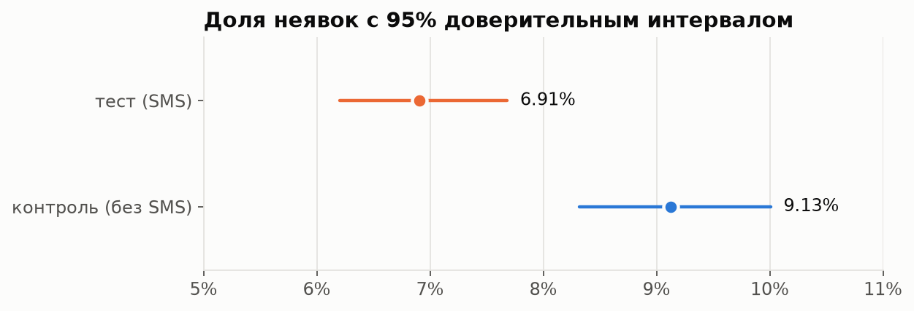
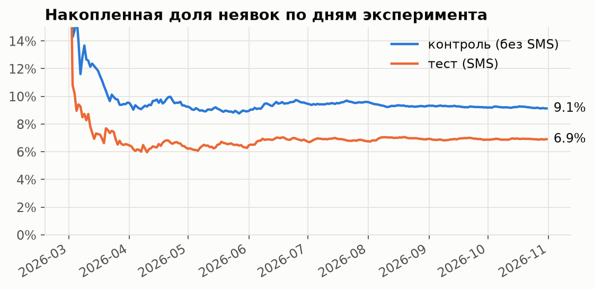

# A/B-тест: SMS-напоминания и неявки

Полный анализ — в ноутбуке [`ab_sms_reminders.ipynb`](ab_sms_reminders.ipynb) (GitHub показывает его с графиками и таблицами).
Статистические функции — в [`abtest.py`](abtest.py), каждая с объяснением и тестами.

## Коротко

**Задача.** Каждая неявка — пустой слот врача и потерянная выручка. Клиника 8 месяцев тестировала SMS-напоминание накануне приёма: каждую запись хотя бы за день до приёма монетка 50/50 отправляла в тест (SMS) или контроль (без SMS).

**Результат.** SMS снижают долю неявок **с 9,1% до 6,9% — на 24%** (95% ДИ [−34%; −13%], p = 0,0001).



**Решение.** Включить напоминания для всех записей хотя бы за день: около **25 сохранённых приёмов в месяц**, 35–69 тыс. ₽ дополнительной выручки при расходах на SMS около 6 тыс. ₽ — окупается в 6–12 раз.

## Что проверено

| Шаг | Зачем | Итог |
| --- | --- | --- |
| **SRM** — совпадает ли сплит с 50/50 | сломанный сплит обесценивает любые выводы | 50,2% в тесте, p = 0,72; ни одной недели с перекосом |
| **Баланс групп** (SMD) | рандомизация должна дать похожие группы | max \|SMD\| = 0,047 при пороге 0,1 |
| **Ловушка наивного сравнения** | SMS не получают записи «в тот же день», и сравнение всех приёмов смещено | наивно −17% вместо −24%: эффект занижен на треть |
| **Z-тест долей** + ДИ для абсолютного и относительного эффекта | основная оценка | −2,2 п.п. [−3,3; −1,1] |
| **Стабильность во времени** | эффект не держится на одной неделе и не угасает | значим в обеих половинах, интервалы пересекаются |
| **Кластерный бутстрап по клиентам** | у клиента несколько записей — наблюдения зависимы | ошибка больше всего в 1,04 раза, вывод тот же |
| **CUPED** с риском, оценённым до эксперимента | сузить интервал | −1% дисперсии: для бинарной метрики со слабой ковариатой выигрыш мал — и это тоже результат |
| **Мощность и MDE** | хватало ли выборки | MDE −19%; эффект −24% выше порога, мощность 97% |
| **A/A-тесты** на данных до эксперимента | проверить сам критерий | 5,0% ложных срабатываний при номинальных 5% |
| **Подглядывание** | показать, почему нельзя останавливать тест при первом p < 0,05 | ложных срабатываний 48% вместо 4% |
| **Сегменты** с поправкой Холма | где эффект сильнее | разница между сегментами не доказана — таргетировать SMS по ним нельзя |
| **Барьерные метрики** | SMS не должны ломать другое | отмены не выросли; выручка на запись не изменилась значимо (слишком шумная) |



## Термины

- **Единица рандомизации** — что именно делит монетка: здесь запись на приём, а не клиент.
- **p-value** — вероятность увидеть такую же или бо́льшую разницу, если на самом деле эффекта нет. Не «вероятность, что гипотеза верна».
- **Доверительный интервал (ДИ)** — диапазон значений эффекта, согласующихся с данными; при повторении эксперимента 95%-интервал накрывает истинный эффект в 95% случаев.
- **Мощность** — вероятность заметить эффект, если он есть. **MDE** — самый маленький эффект, который тест заметит с мощностью 80%.
- **SRM (sample ratio mismatch)** — расхождение фактического сплита с задуманным; признак бага в эксперименте.
- **CUPED** — уменьшение дисперсии метрики за счёт признака, известного до эксперимента.
- **Поправка на множественные сравнения** — когда проверяем много гипотез, шанс случайной «значимости» растёт; поправка Холма это компенсирует.
- **Барьерная метрика (guardrail)** — метрика, которая не должна ухудшиться, даже если основная выросла.

## Запуск

Нужна собранная база с метриками (`make all` из корня репозитория).

```bash
make analysis-venv   # один раз: окружение с зависимостями
make ab              # выполнить ноутбук на текущих данных и обновить графики в figures/
```

Подключение к базе берётся из переменных `PGHOST`, `PGUSER`, … или из `.env` в корне (`db.py`). Данные — представление `metrics.experiment_visits` из [`dwh/metrics/08_experiment.sql`](../dwh/metrics/08_experiment.sql).

Тесты статистики: `cd analysis && .venv/bin/python -m pytest -q`. Они сверяют формулы со `scipy` (z² = χ²), проверяют покрытие 95%-интервала на симуляциях, долю ложных срабатываний A/A-тестов и рост ошибок при подглядывании. В CI ноутбук выполняется целиком на свежей базе.

## Ограничения

- Рандомизация по записям, а не по клиентам: клиент, получавший SMS, мог стать пунктуальнее и в записях без SMS. Тогда эффект недооценён.
- Данные синтетические, с заложенным эффектом −30%: он попадает в доверительный интервал, что заодно проверяет методику.
- Следующие тесты: время отправки (за день или за 2 часа) и текст с кнопкой отмены — чтобы неявки превращались в отмены и слот успевали отдать.
