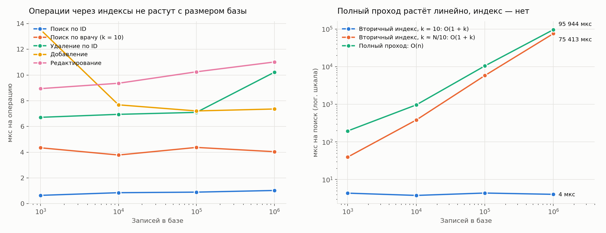

# Лабораторная работа №2. Файловая база данных «Приёмы ветклиники»

**Автор:** Степан Кельзин · НИУ ВШЭ — Нижний Новгород, «Компьютерные науки и технологии»

**Код:** [`storage-engine/`](../../storage-engine) · язык Go, интерфейс Fyne

Реализована однотабличная файловая база данных с графическим интерфейсом. Добавление, поиск, удаление и редактирование по ключу выполняются за O(1) в среднем, поиск и удаление по индексированному неключевому полю — за O(1 + k), где k — число найденных записей. Все операции работают напрямую с файлами через чтение и запись по смещению; в память таблица загружается только для отображения на экране.

## 1. Предметная область

База продолжает [лабораторную работу №1](../lab1/README.md) — информационную систему ветеринарной клиники VetCare. Из её модели взята центральная сущность **«Приём»**: каждый визит животного к врачу. Для однотабличной базы приём денормализован — кличка, вид и врач хранятся прямо в записи.

| Поле | Тип | Размер в файле | Роль |
| --- | --- | --- | --- |
| `visit_id` | целое (int32) | 4 байта | **ключ**, уникален, хеш-индекс |
| `pet_name` | строка UTF-8 | 48 байт | кличка животного |
| `species` | строка UTF-8 | 32 байта | вид животного, **вторичный индекс** |
| `doctor` | строка UTF-8 | 64 байта | врач, **вторичный индекс** |
| `visit_datetime` | дата и время (int64, unix) | 8 байт | когда назначен приём |
| `status` | перечисление (uint8) | 1 байт | запланирован / состоялся / отменён / не пришёл |
| `price` | вещественное (float64) | 8 байт | стоимость, ₽ |

Типичные запросы в клинике: найти приём по номеру, все приёмы врача (расписание), все приёмы по виду животного (например, кошки на вакцинацию); удалить ошибочную запись или все записи уволившегося врача.

## 2. Архитектура

```
cmd/vetdb  → ui → db → heap, hashfile → record
cmd/bench  ────────┘    export → db
```

| Пакет | Ответственность |
| --- | --- |
| `record` | модель приёма, кодирование записи ровно в 198 байт и обратно, валидация |
| `hashfile` | хеш-таблица на диске: ключ фиксированной длины → int64 |
| `heap` | файл записей: слоты фиксированной длины, список свободных слотов |
| `db` | фасад: связывает файл записей и три индекса, все операции над таблицей |
| `export` | выгрузка в Excel (.xlsx) |
| `ui` | интерфейс на Fyne; работает только через пакет `db` |

## 3. Формат файлов

База — это папка с четырьмя файлами.

| Файл | Содержимое |
| --- | --- |
| `visits.dat` | записи приёмов |
| `key.idx` | хеш-индекс `visit_id → смещение записи` |
| `species.idx` | хеш-индекс `вид → смещение первой записи цепочки` |
| `doctor.idx` | хеш-индекс `врач → смещение первой записи цепочки` |

### 3.1. Файл записей `visits.dat`

Заголовок 64 байта: подпись `VETHEAP1`, размер записи (198), число слотов, число живых записей, голова списка свободных слотов. Далее слоты по 198 байт; слот i лежит по смещению `64 + i × 198`, поэтому переход к записи — одно чтение по вычисленному адресу.

| Смещение | Байт | Поле |
| --- | --- | --- |
| 0 | 1 | флаг: 1 — живая запись, 0 — свободный слот |
| 1 | 4 | visit_id |
| 5 | 48 | pet_name, UTF-8 + нули |
| 53 | 32 | species |
| 85 | 64 | doctor |
| 149 | 8 | visit_datetime |
| 157 | 1 | status |
| 158 | 8 | price |
| 166 | 32 | ссылки prevSpecies, nextSpecies, prevDoctor, nextDoctor (4 × int64) |

Все числа — little-endian. Строки обрезаются по границе символа UTF-8: кириллическая буква занимает 2 байта, поэтому в кличку помещается 24 русские буквы. Пустая ссылка обозначается −1, потому что смещение 0 — реальный адрес.

### 3.2. Индексы `*.idx`

Заголовок 64 байта: подпись `VETHASH1`, длина ключа, число слотов (степень двойки), число ключей, число удалённых слотов. Слот: состояние (пусто / занято / удалено), ключ, значение int64. Нулевой слот считается пустым, поэтому новая таблица — это заголовок и нули.

## 4. Алгоритмы

### 4.1. Хеш-индекс с открытой адресацией

- **Хеш:** FNV-1a (64 бита), номер слота = `hash & (capacity − 1)`.
- **Коллизии:** линейное пробирование — если слот занят чужим ключом, проверяется следующий. Пустой слот означает, что ключа нет.
- **Удаление:** слот помечается «удалено» (tombstone), а не очищается, иначе поиск ключей дальше по цепочке остановится на дыре. Если следующий слот пуст, через удаляемый не проходит ни одна цепочка, и он сразу очищается.
- **Вставка** переиспользует первый встреченный tombstone.
- **Rehash:** когда (ключи + tombstone) превышают 70% слотов, таблица перестраивается во временный файл и подменяет старый атомарным `rename`. Размер удваивается, только если живых ключей больше половины; иначе перестройка просто вычищает tombstone. Rehash стоит O(n), но происходит после Θ(n) вставок, поэтому амортизированная стоимость вставки — O(1).

### 4.2. Список свободных слотов

Удалённая запись затирается, а её слот становится головой односвязного списка; ссылка на следующий свободный слот хранится в самом слоте. Новая запись занимает голову списка, и только если он пуст, файл растёт. Записи никогда не сдвигаются, поэтому смещения в индексах остаются верными.

### 4.3. Вторичные индексы: двусвязные цепочки

Все записи с одинаковым видом (врачом) связаны в двусвязный список через ссылки prev/next внутри записей. Индекс хранит только смещение головы.

```
species.idx: "Кошка" → [приём 5] ⇄ [приём 3] ⇄ [приём 1] → −1
```

- **Добавление** ставит запись в голову цепочки: O(1).
- **Удаление одной записи** соединяет её соседей между собой: O(1). Если удаляется голова, индекс переводится на следующую запись; если цепочка опустела, значение удаляется из индекса.
- **Поиск по значению** — переход к голове и проход по цепочке: O(1 + k).
- **Редактирование** переносит запись в другую цепочку, только если изменилось индексированное поле.

### 4.4. Порядок записи

Запись попадает на диск раньше, чем на неё начинает ссылаться любой индекс.

- **Добавление:** слот резервируется, ссылки новой записи на соседей по цепочкам вычисляются в памяти (`prepare`), запись пишется целиком; только после этого старые головы цепочек начинают указывать на неё, индексы вида и врача переводятся на неё (`attach`), и последним обновляется индекс ключа.
- **Удаление:** в обратном порядке — запись отстёгивается от обеих цепочек, убирается из индекса ключа, и только потом слот освобождается.
- **Редактирование** со сменой вида или врача: запись отстёгивается от старой цепочки, пишется с новыми ссылками и только затем пристёгивается к новой.

Так сбой посередине операции не оставляет в индексе ссылку на несуществующую запись. При открытии база проверяет, что число записей совпадает с числом ключей, и при расхождении сообщает о повреждении.

## 5. Сложность операций

| Операция | В среднем | В худшем случае |
| --- | --- | --- |
| Добавление (с проверкой уникальности ключа) | O(1) амортизированно | O(n) — rehash или все ключи в одной цепочке пробирования |
| Поиск по ключу | O(1) | O(n) |
| Удаление по ключу | O(1) | O(n) |
| Редактирование | O(1) | O(n) |
| Поиск по виду / врачу | O(1 + k) | O(n) |
| Удаление по виду / врачу | O(1 + k) | O(n) |
| Поиск / удаление по кличке или статусу (без индекса) | O(n) | O(n) |
| Очистка | O(1) | O(1) |
| Резервная копия, восстановление, экспорт | O(n) | O(n) |

Худший случай для хеш-индекса на практике не достигается: хеш равномерно распределяет и последовательные номера, и строки, а при заполнении не выше 70% ожидаемая длина пробирования — 2–3 слота.

Память: O(1) на операцию, кроме результатов поиска (O(k)) и таблицы на экране (O(n)). Диск: 198 байт на запись плюс 13 байт на слот индекса ключа (слотов в 1,4–2,8 раза больше, чем ключей, из-за порога заполнения 70%). Индексы по виду и врачу хранят только различные значения и почти не занимают места. Миллион записей занимает 225 МБ.

## 6. Временная статистика

### 6.1. Методика

Программа [`cmd/bench`](../../storage-engine/cmd/bench/main.go) для каждого размера N создаёт новую базу из N случайных приёмов (10 видов, 50 врачей) и контрольной группы из 10 приёмов с одним врачом и одной кличкой. Затем она измеряет:

- 1000 добавлений, поисков, редактирований (со сменой врача) и удалений по случайным ключам (500 при N = 1000);
- 1000 поисков по контрольному врачу: всегда ровно 10 результатов, так что k не зависит от N;
- 3 поиска по виду: k ≈ N/10;
- 3 поиска по кличке: полный проход по файлу;
- удаление контрольной группы по врачу.

Окружение: Linux (aarch64, 4 ядра, 3 ГБ ОЗУ) в виртуальной машине на MacBook Air, Go 1.24.7, файлы на локальном диске, без `fsync` после каждой операции. Сырые данные — [`bench.csv`](bench.csv), график строит [`plot.py`](plot.py).

### 6.2. Результаты

Время одной операции, мкс:

| Операция | N = 1 000 | N = 10 000 | N = 100 000 | N = 1 000 000 | Сложность |
| --- | ---: | ---: | ---: | ---: | --- |
| Добавление | 13,5 | 7,7 | 7,2 | 7,4 | O(1) |
| Поиск по ID | 0,6 | 0,9 | 0,9 | 1,0 | O(1) |
| Редактирование | 8,9 | 9,4 | 10,3 | 11,0 | O(1) |
| Удаление по ID | 6,7 | 6,9 | 7,1 | 10,2 | O(1) |
| Поиск по врачу, k = 10 | 4,3 | 3,8 | 4,4 | 4,0 | O(1 + k) |
| Удаление по врачу, k = 10 | 65,8 | 72,3 | 83,8 | 97,0 | O(k) |
| Поиск по виду, k ≈ N/10 | 40 | 382 | 5 785 | 75 413 | O(1 + k) |
| Поиск по кличке, полный проход | 195 | 963 | 10 445 | 95 944 | O(n) |

Загрузка миллиона записей заняла 8,5 с — в среднем 8,5 мкс на добавление; файлы базы заняли 225 МБ.



### 6.3. Анализ

1. **Операции по ключу не зависят от размера базы.** При росте N в 1000 раз поиск по ID остаётся около 1 мкс, добавление — около 7 мкс, удаление и редактирование — 7–11 мкс. Это подтверждает O(1). Добавление дороже поиска, потому что пишет запись, заголовок, обе цепочки и три индекса — около 10 обращений к диску против одного-двух у поиска.
2. **Выброс при N = 1000** (добавление 13,5 мкс) — это rehash: 500 новых ключей переполнили индекс на 2048 слотов, и его перестройка разделилась на небольшое число вставок. На больших N 1000 вставок до порога не доходят. Это наглядная иллюстрация амортизированной сложности.
3. **Небольшой рост удаления и редактирования при N = 1 000 000** (7 → 10 мкс) объясняется не алгоритмом, а кешем: файлы весят 225 МБ, и случайные обращения к ним чаще промахиваются мимо кеша процессора и страниц ОС. Число операций с файлами при этом не меняется.
4. **Вторичный индекс работает за O(1 + k).** Поиск по врачу с фиксированным k = 10 стоит 4 мкс при любом N. Поиск по виду растёт вместе с N только потому, что растёт k ≈ N/10: время пропорционально числу найденных записей, а не размеру файла.
5. **Полный проход растёт линейно:** с 0,2 мс до 96 мс при росте N в 1000 раз. На миллионе записей поиск по индексу (4 мкс) быстрее полного прохода (96 мс) примерно в 24 000 раз.
6. **Удаление по неключевому полю** стоит O(k): для 10 записей — 66–97 мкс при любом N, то есть 7–10 мкс на запись, как у удаления по ключу.

## 7. Тестирование

- Модульные тесты для каждого пакета; общее покрытие `internal/` — около 76%.
- Рандомизированные тесты сверяют базу с обычной структурой в памяти: 20 000 операций для хеш-индекса, 10 000 для файла записей, 6 000 для всей базы (добавления, редактирования со сменой ключа, удаления по ключу, виду и врачу), с периодическим переоткрытием файлов.
- Проверка целостности после операций: индекс ключа указывает на верные записи, каждая цепочка — корректный двусвязный список.
- Повреждённые и обрезанные файлы, несогласованные индексы, битая резервная копия — каждая ситуация даёт понятную ошибку, а не работу с мусором.
- `pre-commit` (gofmt, go vet, тесты) и GitHub Actions с порогом покрытия 60%.

## 8. Функции программы

| Требование | Где в интерфейсе |
| --- | --- |
| Создание, открытие, сохранение, очистка, удаление БД | меню «Файл» |
| Добавление с проверкой уникальности ключа | «Добавить»: при занятом ID — сообщение об ошибке |
| Удаление по ключу | выбрать строку → «Удалить выбранную», или поиск по ID → «Удалить найденные» |
| Удаление по неключевому полю (все совпадения) | поиск по виду, врачу, кличке или статусу → «Удалить найденные» |
| Поиск по ключу и неключевому полю с выводом результатов | панель поиска; результаты в таблице, время и способ поиска — в строке статуса |
| Редактирование | выбрать строку → «Редактировать» |
| Резервная копия и восстановление | «Файл» → «Создать резервную копию» / «Восстановить из копии» |
| Экспорт в .xlsx | «Файл» → «Экспорт в Excel» |

## 9. Запуск

```bash
cd storage-engine
go run ./cmd/vetdb                       # приложение
go test ./internal/...                   # тесты
go run ./cmd/bench -out ../docs/lab2/bench.csv && (cd ../docs/lab2 && python3 plot.py)   # замеры и график
```

Для сборки на macOS нужны Go 1.24+ и Xcode Command Line Tools.
