# Лабораторная работа № 3. SQL-запросы к базе данных полётов

- **Дисциплина** — «Управление данными»
- **Вариант** — 15
- **Выполнил** — Степан Кельзин, НИУ ВШЭ — Нижний Новгород
- **СУБД** — PostgreSQL 16

## Схема базы данных

Каждая запись в `flight` относится к одному пилоту, одному штурману и одному рейсу. У каждого из этих трёх справочников связь с таблицей полётов «один ко многим».

| Таблица | Первичный ключ | Остальные поля |
| --- | --- | --- |
| `pilot` — пилоты | `pilot_id` | Фамилия, авиаотряд, лимит часов |
| `navigator` — штурманы | `navigator_id` | Фамилия, авиаотряд, лимит часов |
| `route` — рейсы | `route_id` | Пункт назначения, авиаотряд обслуживающего персонала, время полёта, коэффициент сложности |
| `flight` — полёты | `flight_id` | Месяц, ссылки на пилота, штурмана и рейс, число вылетов и часы. В задании 1.9 добавляется процент от лимита пилота. |

Идентификаторы и число вылетов хранятся как `integer`, месяц — как `smallint`, фамилии и названия — как `text`. Тип `numeric` позволяет хранить и точно считать дробные часы, коэффициенты и проценты. Первичные ключи задают уникальность записей, внешние ключи проверяют ссылки на справочники. `NOT NULL` делает поля обязательными, а `CHECK` проверяет диапазон месяцев, положительные числа и непустой текст.

## Исходные данные

Загружены все строки раздела 15 из файла `forLab3_содержимое таблиц.txt` — 5 пилотов, 6 штурманов, 7 рейсов и 17 записей о полётах. В приложении указаны месяцы, поэтому они хранятся как числа от 1 до 12. У рейса «Москва» исправлена опечатка в названии обслуживающего авиаотряда, `Нижегродский` → `Нижегородский`.

В приложении нет значений коэффициента сложности. Для этой работы выбрана формула `1 + (время рейса в часах − 1) × 0,1`. Каждый дополнительный час увеличивает коэффициент на 0,1. Например, для рейса длительностью 4 часа коэффициент равен 1,3.

Уровень 1 выполнен в порядке заданий. Уровень 2 использует часы после пересчёта в 1.8. Снимки показывают результаты выполнения в PostgreSQL через `psql`. Примеры дополнений для пустых выборок проверены в отдельных транзакциях с откатом.

## Уровень 1

### Задание 1.1

Создать таблицы пилотов, штурманов, рейсов и полётов средствами SQL и обеспечить их целостность.

```sql
CREATE SCHEMA lab3_v15;
SET search_path TO lab3_v15;

CREATE TABLE pilot (
    pilot_id integer PRIMARY KEY,
    surname text NOT NULL CHECK (btrim(surname) <> ''),
    squadron text NOT NULL CHECK (btrim(squadron) <> ''),
    hour_limit numeric(7, 2) NOT NULL CHECK (hour_limit > 0)
);

CREATE TABLE navigator (
    navigator_id integer PRIMARY KEY,
    surname text NOT NULL CHECK (btrim(surname) <> ''),
    squadron text NOT NULL CHECK (btrim(squadron) <> ''),
    hour_limit numeric(7, 2) NOT NULL CHECK (hour_limit > 0)
);

CREATE TABLE route (
    route_id integer PRIMARY KEY,
    destination text NOT NULL CHECK (btrim(destination) <> ''),
    service_squadron text NOT NULL CHECK (btrim(service_squadron) <> ''),
    duration_hours numeric(7, 2) NOT NULL CHECK (duration_hours > 0),
    difficulty_factor numeric(6, 3) NOT NULL CHECK (difficulty_factor > 0)
);

CREATE TABLE flight (
    flight_id integer PRIMARY KEY,
    flight_month smallint NOT NULL CHECK (flight_month BETWEEN 1 AND 12),
    pilot_id integer NOT NULL REFERENCES pilot (pilot_id),
    navigator_id integer NOT NULL REFERENCES navigator (navigator_id),
    route_id integer NOT NULL REFERENCES route (route_id),
    departure_count integer NOT NULL CHECK (departure_count > 0),
    flight_hours numeric(14, 5) NOT NULL CHECK (flight_hours > 0)
);
```

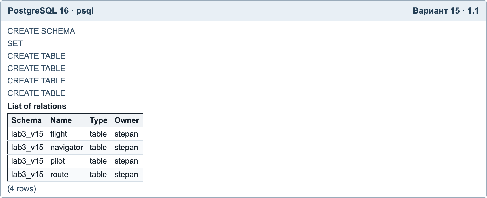

### Задание 1.2

Заполнить созданные таблицы строками варианта 15 из приложения к заданию.

Загруженные строки показаны в задании 1.3. Коэффициент вычисляется по формуле из раздела «Исходные данные».

```sql
INSERT INTO pilot (pilot_id, surname, squadron, hour_limit) VALUES
    (1, 'Ляпин', 'Нижегородский', 50),
    (2, 'Иванов', 'Московский1', 48),
    (3, 'Поливцев', 'Московский2', 32),
    (4, 'Святов', 'Московский3', 49),
    (5, 'Шубенков', 'Волгоградский', 50);

INSERT INTO navigator (navigator_id, surname, squadron, hour_limit) VALUES
    (1, 'Сидельников', 'Московский1', 48),
    (2, 'Бобылёв', 'Московский2', 48),
    (3, 'Самарин', 'Московский3', 50),
    (4, 'Платонов', 'Нижегородский', 49),
    (5, 'Куленков', 'Волгоградский', 50),
    (6, 'Овчинников', 'С.-Петербургский', 49);

INSERT INTO route (
    route_id, destination, service_squadron, duration_hours, difficulty_factor
)
SELECT route_id, destination, service_squadron, duration_hours,
       1 + (duration_hours - 1) * 0.1
FROM (VALUES
    (1, 'Москва', 'Нижегородский', 1),
    (2, 'Пермь', 'Нижегородский', 3),
    (3, 'Волгоград', 'Волгоградский', 2),
    (4, 'Хабаровск', 'Московский2', 4),
    (5, 'С.-Петербург', 'Московский2', 2),
    (6, 'Ижевск', 'Московский3', 2),
    (7, 'Мурманск', 'Московский1', 2)
) AS routes(route_id, destination, service_squadron, duration_hours);

INSERT INTO flight (
    flight_id, flight_month, pilot_id, navigator_id, route_id, departure_count, flight_hours
) VALUES
    (12500,  1, 1, 1, 4, 3, 12),
    (12501,  1, 1, 4, 3, 4,  8),
    (12502,  1, 3, 2, 7, 3,  6),
    (12503,  2, 2, 4, 3, 4,  8),
    (12504,  2, 4, 3, 3, 5, 10),
    (12505,  3, 1, 1, 3, 4,  8),
    (12506,  4, 1, 4, 2, 3,  9),
    (12507,  4, 2, 5, 7, 4,  8),
    (12508,  4, 5, 6, 4, 3, 12),
    (12509,  5, 2, 3, 4, 4, 16),
    (12510,  6, 5, 5, 1, 4,  4),
    (12511,  7, 1, 1, 4, 4, 16),
    (12512,  8, 1, 2, 2, 4, 12),
    (12513,  9, 5, 6, 7, 3,  6),
    (12514, 12, 1, 1, 1, 4,  4),
    (12515, 12, 2, 5, 5, 6, 12),
    (12516, 12, 1, 4, 4, 4, 16);
```

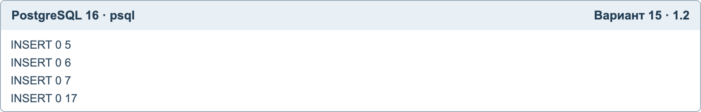

### Задание 1.3 — пилоты

Вывести все строки таблицы пилотов и проверить загрузку.

```sql
SELECT * FROM pilot ORDER BY pilot_id;
```

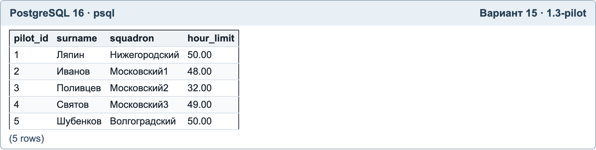

### Задание 1.3 — штурманы

Вывести все строки таблицы штурманов и проверить загрузку.

```sql
SELECT * FROM navigator ORDER BY navigator_id;
```

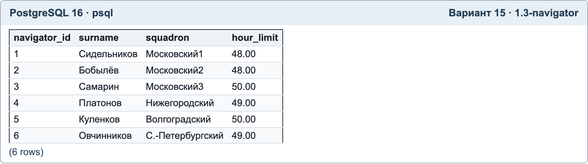

### Задание 1.3 — рейсы

Вывести все строки таблицы рейсов и проверить загрузку.

```sql
SELECT * FROM route ORDER BY route_id;
```

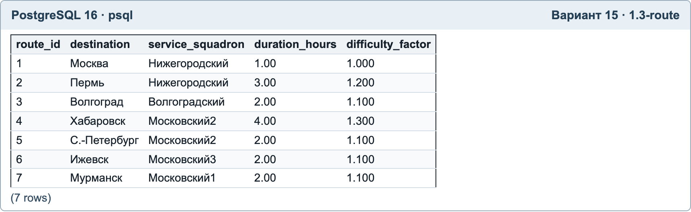

### Задание 1.3 — полёты

Вывести все строки таблицы полётов и проверить загрузку.

В столбце `flight_month` число от 1 до 12 обозначает месяц от января до декабря.

```sql
SELECT * FROM flight ORDER BY flight_id;
```

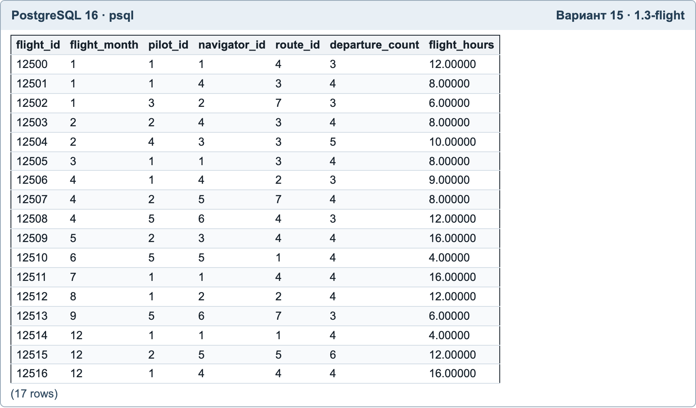

### Задание 1.4а

Вывести все различные авиаотряды, в которых есть пилоты.

```sql
SELECT DISTINCT squadron
FROM pilot
ORDER BY squadron;
```

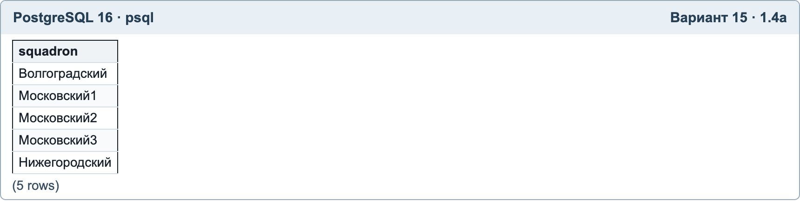

### Задание 1.4б

Вывести все различные пункты назначения рейсов.

```sql
SELECT DISTINCT destination
FROM route
ORDER BY destination;
```

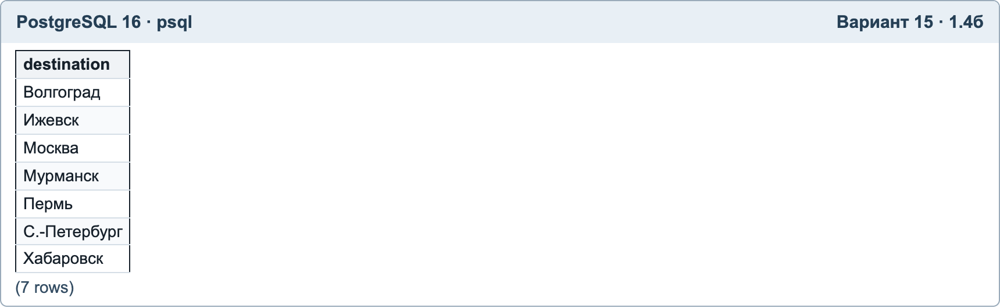

### Задание 1.4в

Вывести все различные значения лимита часов штурманов.

```sql
SELECT DISTINCT hour_limit
FROM navigator
ORDER BY hour_limit;
```

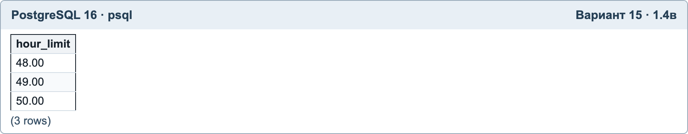

### Задание 1.5а

Вывести фамилии и авиаотряды пилотов с лимитом больше 30 часов.

```sql
SELECT surname, squadron
FROM pilot
WHERE hour_limit > 30
ORDER BY surname, pilot_id;
```

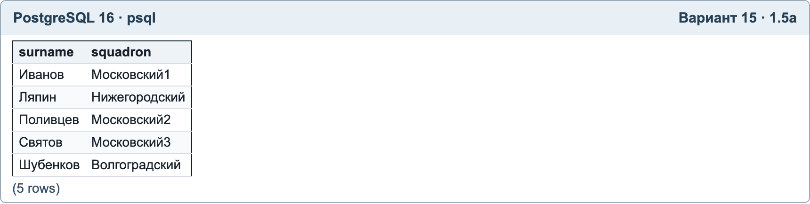

### Задание 1.5б

Вывести пункты назначения рейсов, которые обслуживает Нижегородский авиаотряд.

```sql
SELECT DISTINCT destination
FROM route
WHERE service_squadron = 'Нижегородский'
ORDER BY destination;
```

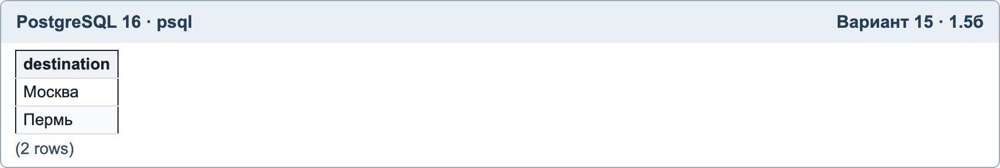

### Задание 1.5в

Вывести номер записи, месяц и фамилию пилота для полётов, где число часов превысило 8.

```sql
SELECT f.flight_id, f.flight_month, p.surname AS pilot
FROM flight AS f
JOIN pilot AS p USING (pilot_id)
WHERE f.flight_hours > 8
ORDER BY f.flight_id;
```

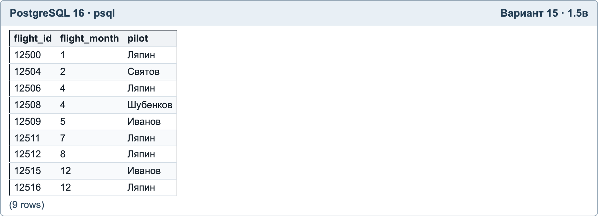

### Задание 1.6а

Вывести номера записей, фамилии пилотов и число часов. Отсортировать по числу часов.

```sql
SELECT f.flight_id, p.surname AS pilot, f.flight_hours
FROM flight AS f
JOIN pilot AS p USING (pilot_id)
ORDER BY f.flight_hours, f.flight_id;
```

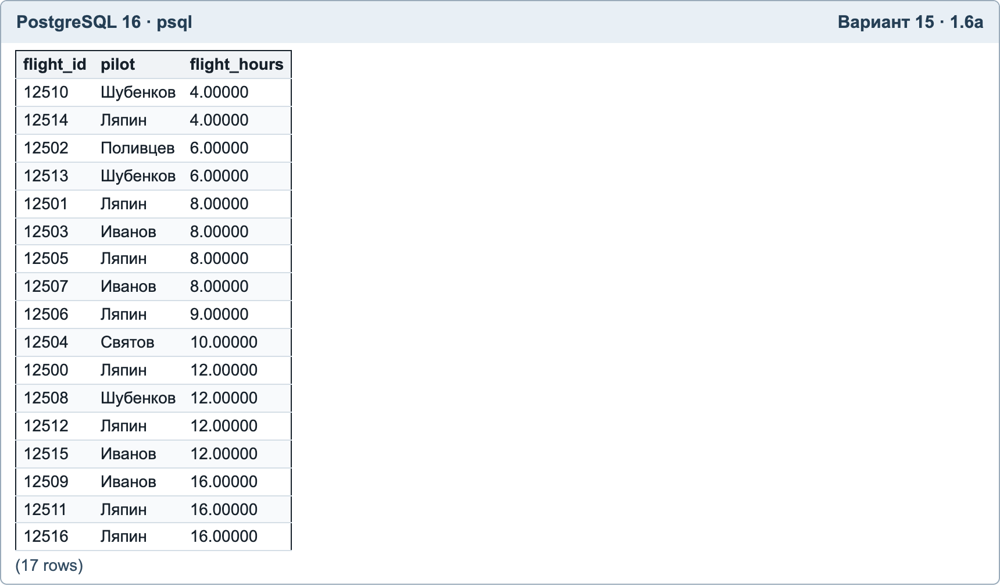

### Задание 1.6б

Вывести пункт назначения, число вылетов, фамилию штурмана и месяц для каждого полёта.

```sql
SELECT r.destination, f.departure_count, n.surname AS navigator, f.flight_month
FROM flight AS f
JOIN route AS r USING (route_id)
JOIN navigator AS n USING (navigator_id)
ORDER BY f.flight_month, f.flight_id;
```

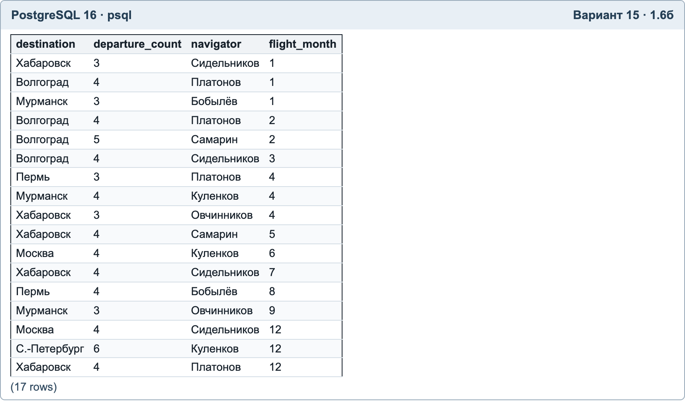

### Задание 1.7а

Вывести фамилии штурманов, летавших в Хабаровск или с пилотами своего авиаотряда.

```sql
SELECT DISTINCT n.surname
FROM flight AS f
JOIN route AS r USING (route_id)
JOIN navigator AS n USING (navigator_id)
JOIN pilot AS p USING (pilot_id)
WHERE r.destination = 'Хабаровск' OR n.squadron = p.squadron
ORDER BY n.surname;
```

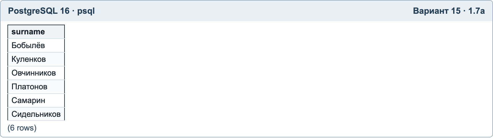

### Задание 1.7б

Вывести фамилии и лимиты пилотов на рейсах со временем полёта больше трёх часов не ранее февраля.

Февраль включается.

```sql
SELECT DISTINCT p.surname, p.hour_limit
FROM flight AS f
JOIN route AS r USING (route_id)
JOIN pilot AS p USING (pilot_id)
WHERE r.duration_hours > 3 AND f.flight_month >= 2
ORDER BY p.surname, p.hour_limit;
```

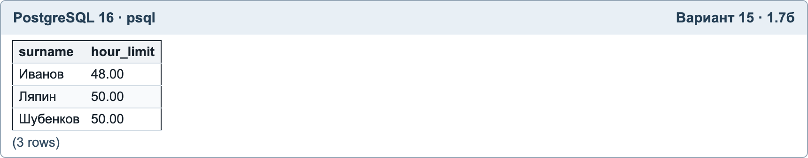

### Задание 1.7в

Вывести фамилии и авиаотряды штурманов, летавших с Поливцевым более одного раза.

Число совместных вылетов вычисляется как сумма departure_count.

```sql
SELECT n.surname, n.squadron
FROM flight AS f
JOIN pilot AS p USING (pilot_id)
JOIN navigator AS n USING (navigator_id)
WHERE p.surname = 'Поливцев'
GROUP BY p.pilot_id, n.navigator_id
HAVING SUM(f.departure_count) > 1
ORDER BY n.surname, n.navigator_id;
```

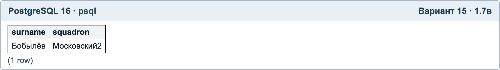

### Задание 1.7г

Вывести идентификаторы и пункты назначения рейсов со штурманами С.-Петербургского авиаотряда, добавить фамилии штурманов и отсортировать по пункту назначения.

```sql
SELECT DISTINCT r.route_id, r.destination, n.surname AS navigator
FROM flight AS f
JOIN navigator AS n USING (navigator_id)
JOIN route AS r USING (route_id)
WHERE n.squadron = 'С.-Петербургский'
ORDER BY r.destination, r.route_id, navigator;
```

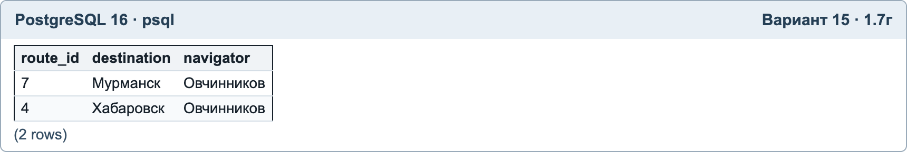

### Задание 1.8

Обновить суммарное число часов каждого полёта с учётом коэффициента сложности рейса и вывести новые значения.

Скорректированные часы равны исходным часам, умноженным на коэффициент сложности.

```sql
UPDATE flight AS f
SET flight_hours = f.flight_hours * r.difficulty_factor
FROM route AS r
WHERE r.route_id = f.route_id;

SELECT flight_id, flight_hours
FROM flight
ORDER BY flight_id;
```

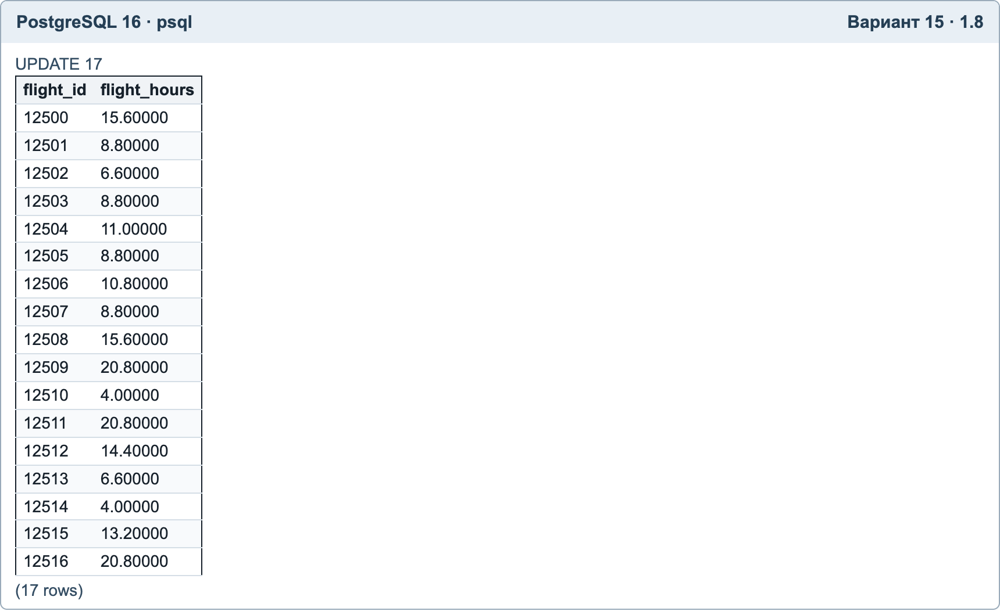

### Задание 1.9

Добавить столбец с процентом налёта пилота от его лимита часов и заполнить его для всех записей.

Процент рассчитывается от скорректированных часов и округляется до двух знаков.

```sql
ALTER TABLE flight ADD COLUMN hours_limit_pct numeric(20, 2);

UPDATE flight AS f
SET hours_limit_pct = round(100 * f.flight_hours / p.hour_limit, 2)
FROM pilot AS p
WHERE p.pilot_id = f.pilot_id;

ALTER TABLE flight
    ALTER COLUMN hours_limit_pct SET NOT NULL,
    ADD CHECK (hours_limit_pct >= 0);

SELECT flight_id, flight_hours, hours_limit_pct
FROM flight
ORDER BY flight_id;
```

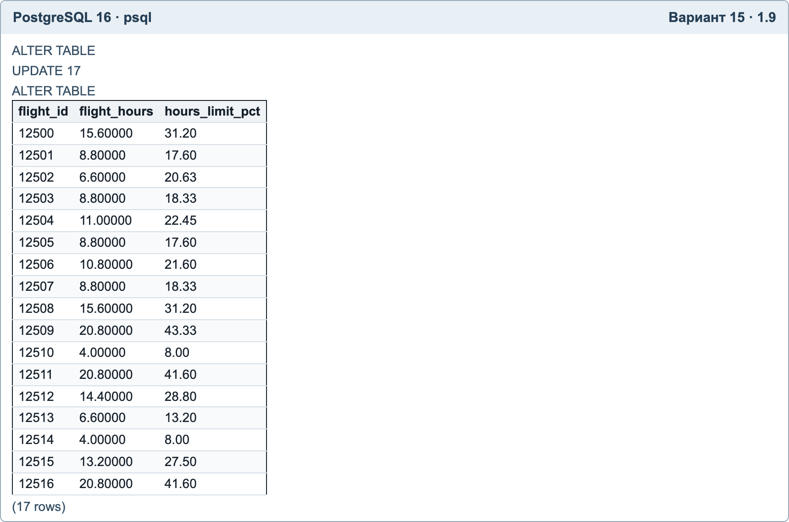

## Уровень 2

### Задание 2.1а

Через IN выбрать пилотов, чей лимит часов совпадает с лимитом хотя бы одного нижегородского штурмана.

```sql
SELECT p.surname, p.hour_limit
FROM pilot AS p
WHERE p.hour_limit IN (
    SELECT n.hour_limit
    FROM navigator AS n
    WHERE n.squadron = 'Нижегородский'
)
ORDER BY p.surname, p.pilot_id;
```

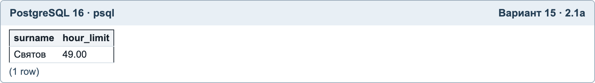

### Задание 2.1б.1

Через IN повторить 1.7а и найти штурманов, летавших в Хабаровск или с пилотами своего авиаотряда.

```sql
SELECT DISTINCT n.surname
FROM navigator AS n
WHERE n.navigator_id IN (
    SELECT f.navigator_id
    FROM flight AS f
    JOIN route AS r USING (route_id)
    JOIN pilot AS p USING (pilot_id)
    WHERE r.destination = 'Хабаровск' OR p.squadron = n.squadron
)
ORDER BY n.surname;
```

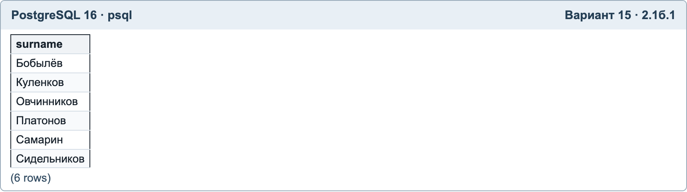

### Задание 2.1б.2

Через IN повторить 1.7б и найти пилотов на рейсах дольше трёх часов с февраля включительно.

```sql
SELECT DISTINCT p.surname, p.hour_limit
FROM pilot AS p
WHERE p.pilot_id IN (
    SELECT f.pilot_id
    FROM flight AS f
    JOIN route AS r USING (route_id)
    WHERE r.duration_hours > 3 AND f.flight_month >= 2
)
ORDER BY p.surname, p.hour_limit;
```


### Задание 2.1в

Через NOT IN выбрать пилотов, которые до декабря не летали в Хабаровск.

Декабрьские вылеты не исключают пилота из результата.

```sql
SELECT p.surname
FROM pilot AS p
WHERE p.pilot_id NOT IN (
    SELECT f.pilot_id
    FROM flight AS f
    JOIN route AS r USING (route_id)
    WHERE r.destination = 'Хабаровск' AND f.flight_month < 12
)
ORDER BY p.surname, p.pilot_id;
```

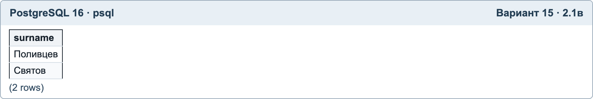

### Задание 2.2а

Через ANY повторить 1.7г и вывести рейсы со штурманами С.-Петербургского авиаотряда.

```sql
SELECT DISTINCT r.route_id, r.destination, n.surname AS navigator
FROM flight AS f
JOIN navigator AS n USING (navigator_id)
JOIN route AS r USING (route_id)
WHERE n.navigator_id = ANY (
    SELECT sn.navigator_id
    FROM navigator AS sn
    WHERE sn.squadron = 'С.-Петербургский'
)
ORDER BY r.destination, r.route_id, navigator;
```

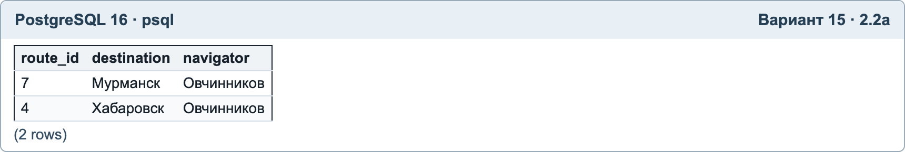

### Задание 2.2б

Через ALL найти все полёты с максимальным числом лётных часов.

При совпадении максимума выводятся все соответствующие записи.

```sql
SELECT f.*
FROM flight AS f
WHERE f.flight_hours >= ALL (SELECT flight_hours FROM flight)
ORDER BY f.flight_id;
```

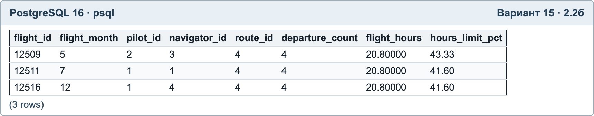

### Задание 2.2в

Через ANY найти пилотов, чей лимит строго больше минимального и строго меньше максимального.

```sql
SELECT p.surname, p.hour_limit
FROM pilot AS p
WHERE p.hour_limit > ANY (SELECT hour_limit FROM pilot)
  AND p.hour_limit < ANY (SELECT hour_limit FROM pilot)
ORDER BY p.hour_limit, p.surname, p.pilot_id;
```

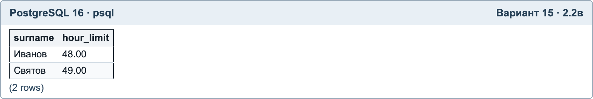

### Задание 2.2г

Через ALL найти рейс с наименьшим коэффициентом сложности среди рейсов, на которых летал Святов.

```sql
WITH svyatov_routes AS (
    SELECT DISTINCT r.route_id, r.destination, r.difficulty_factor
    FROM flight AS f
    JOIN pilot AS p USING (pilot_id)
    JOIN route AS r USING (route_id)
    WHERE p.surname = 'Святов'
)
SELECT route_id, destination, difficulty_factor
FROM svyatov_routes
WHERE difficulty_factor <= ALL (SELECT difficulty_factor FROM svyatov_routes)
ORDER BY route_id;
```

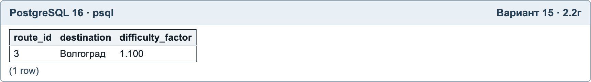

### Задание 2.3

Через UNION получить авиаотряды, в которых работают пилоты или обслуживающий рейсы персонал.

```sql
SELECT squadron
FROM pilot
UNION
SELECT service_squadron
FROM route
ORDER BY squadron;
```


### Задание 2.4а

Через `NOT EXISTS` найти пары «пилот–штурман», работавшие на всех рейсах.

Для каждой найденной пары проверяется, остался ли рейс, на котором она не летала.

```sql
SELECT p.surname AS pilot, n.surname AS navigator
FROM (
    SELECT DISTINCT pilot_id, navigator_id FROM flight
) AS crew
JOIN pilot AS p USING (pilot_id)
JOIN navigator AS n USING (navigator_id)
WHERE NOT EXISTS (
    SELECT 1
    FROM route AS r
    WHERE NOT EXISTS (
        SELECT 1
        FROM flight AS f
        WHERE f.pilot_id = crew.pilot_id
          AND f.navigator_id = crew.navigator_id
          AND f.route_id = r.route_id
    )
)
ORDER BY pilot, navigator, crew.pilot_id, crew.navigator_id;
```

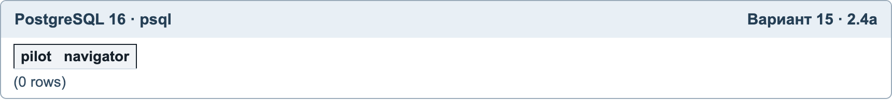

У запроса пустой результат. Если добавить по одному полёту Ляпина и Сидельникова в Пермь, С.-Петербург, Ижевск и Мурманск, эта пара появится в результате. Полёты этой пары в Москву, Волгоград и Хабаровск уже есть.

### Задание 2.4б

Найти рейсы, на которых работают только пилоты Нижегородского авиаотряда и штурманы московских авиаотрядов.

В приложении московские авиаотряды имеют названия «Московский1», «Московский2» и «Московский3». Запрос проверяет название с возможным числовым суффиксом. Для рейса должен быть хотя бы один полёт.

```sql
SELECT r.route_id, r.destination
FROM route AS r
WHERE EXISTS (SELECT 1 FROM flight AS f WHERE f.route_id = r.route_id)
  AND NOT EXISTS (
      SELECT 1
      FROM flight AS f
      JOIN pilot AS p USING (pilot_id)
      JOIN navigator AS n USING (navigator_id)
      WHERE f.route_id = r.route_id
        AND (p.squadron <> 'Нижегородский' OR n.squadron !~ '^Московский[0-9]*$')
  )
ORDER BY r.route_id;
```

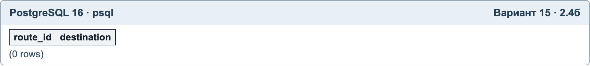

У запроса пустой результат. Если добавить один полёт в Ижевск с Ляпиным и Сидельниковым, Ижевск появится в результате. У этого рейса сейчас нет полётов, а оба члена экипажа удовлетворяют условию.

### Задание 2.4в

Через EXISTS и NOT EXISTS найти штурманов, работавших с нижегородскими пилотами на всех рейсах дольше двух часов.

```sql
SELECT n.surname, n.squadron
FROM navigator AS n
WHERE EXISTS (SELECT 1 FROM route WHERE duration_hours > 2)
  AND NOT EXISTS (
      SELECT 1
      FROM route AS r
      WHERE r.duration_hours > 2
        AND NOT EXISTS (
            SELECT 1
            FROM flight AS f
            JOIN pilot AS p USING (pilot_id)
            WHERE f.route_id = r.route_id
              AND f.navigator_id = n.navigator_id
              AND p.squadron = 'Нижегородский'
        )
  )
ORDER BY n.surname, n.navigator_id;
```

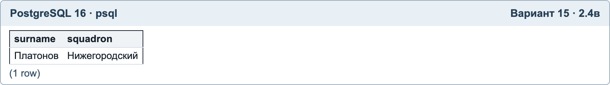

### Задание 2.4г

Через EXISTS и NOT EXISTS найти пилотов, работавших на всех рейсах с обслуживанием другого авиаотряда со всеми штурманами с лимитом больше 48 часов.

Для пилота проверяется каждая комбинация требуемого рейса и штурмана.

```sql
SELECT p.surname, p.squadron
FROM pilot AS p
WHERE EXISTS (SELECT 1 FROM route AS r WHERE r.service_squadron <> p.squadron)
  AND EXISTS (SELECT 1 FROM navigator WHERE hour_limit > 48)
  AND NOT EXISTS (
      SELECT 1
      FROM route AS r
      CROSS JOIN navigator AS n
      WHERE r.service_squadron <> p.squadron AND n.hour_limit > 48
        AND NOT EXISTS (
            SELECT 1
            FROM flight AS f
            WHERE f.pilot_id = p.pilot_id
              AND f.route_id = r.route_id
              AND f.navigator_id = n.navigator_id
        )
  )
ORDER BY p.surname, p.pilot_id;
```

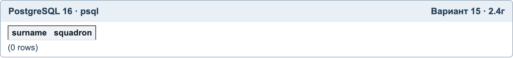

У запроса пустой результат. Чтобы в результате появился Ляпин, достаточно добавить 18 полётов по следующим рейсам.

- Волгоград и Хабаровск — по одному полёту с Самариным, Куленковым и Овчинниковым. Полёты с Платоновым уже есть.
- С.-Петербург, Ижевск и Мурманск — по одному полёту с каждым из четырёх штурманов — Самариным, Платоновым, Куленковым и Овчинниковым.

### Задание 2.5а

Посчитать различные авиаотряды, пилоты которых выполняли полёты.

```sql
SELECT COUNT(DISTINCT p.squadron) AS squadron_count
FROM flight AS f
JOIN pilot AS p USING (pilot_id);
```

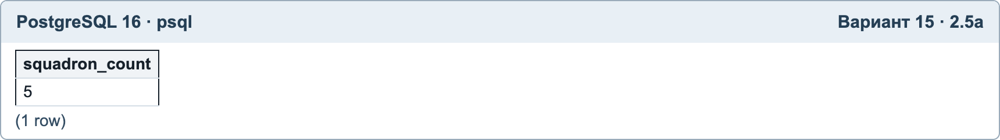

### Задание 2.5б

Найти средний коэффициент сложности рейсов, на которых работали пилоты авиаотряда Московский1.

Каждый подходящий рейс участвует в расчёте один раз.

```sql
SELECT round(AVG(r.difficulty_factor), 3) AS average_difficulty
FROM route AS r
WHERE EXISTS (
    SELECT 1
    FROM flight AS f
    JOIN pilot AS p USING (pilot_id)
    WHERE f.route_id = r.route_id AND p.squadron = 'Московский1'
);
```

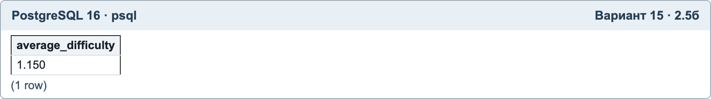

### Задание 2.5в

Для каждого пилота, работавшего на всех рейсах, найти общее число налётанных часов.

На исходных данных нет пилота с полётами по всем семи рейсам.

```sql
SELECT p.surname, SUM(f.flight_hours) AS total_hours
FROM flight AS f
JOIN pilot AS p USING (pilot_id)
GROUP BY p.pilot_id
HAVING COUNT(DISTINCT f.route_id) = (SELECT COUNT(*) FROM route)
ORDER BY p.surname, p.pilot_id;
```

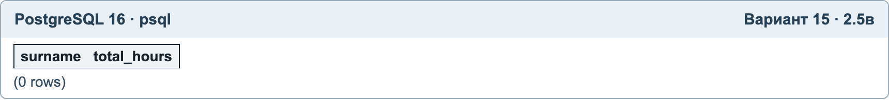

### Задание 2.5г

Найти число вылетов в Хабаровск у пилотов, летавших с Самариным более одного раза.

Работа с Самариным проверяется по всем полётам пилота. У Святова есть вылеты с Самариным в Волгоград, поэтому он подходит по условию, а число его вылетов в Хабаровск равно нулю.

```sql
WITH qualified_pilots AS (
    SELECT f.pilot_id
    FROM flight AS f
    JOIN navigator AS n USING (navigator_id)
    WHERE n.surname = 'Самарин'
    GROUP BY f.pilot_id, n.navigator_id
    HAVING SUM(f.departure_count) > 1
)
SELECT p.surname,
       COALESCE(SUM(f.departure_count) FILTER (WHERE r.destination = 'Хабаровск'), 0)
           AS khabarovsk_departures
FROM pilot AS p
JOIN flight AS f USING (pilot_id)
JOIN route AS r USING (route_id)
WHERE p.pilot_id IN (SELECT pilot_id FROM qualified_pilots)
GROUP BY p.pilot_id
ORDER BY p.surname, p.pilot_id;
```

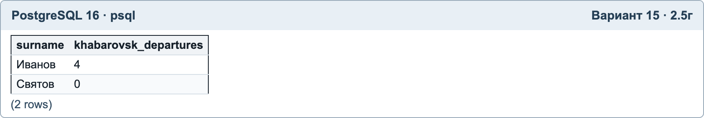

### Задание 2.6а

Для каждого пилота вывести по месяцам города, куда он совершил более одного вылета.

```sql
SELECT p.surname,
       f.flight_month AS month,
       r.destination,
       SUM(f.departure_count) AS departures
FROM flight AS f
JOIN pilot AS p USING (pilot_id)
JOIN route AS r USING (route_id)
GROUP BY p.pilot_id, month, r.destination
HAVING SUM(f.departure_count) > 1
ORDER BY p.surname, p.pilot_id, month, r.destination;
```

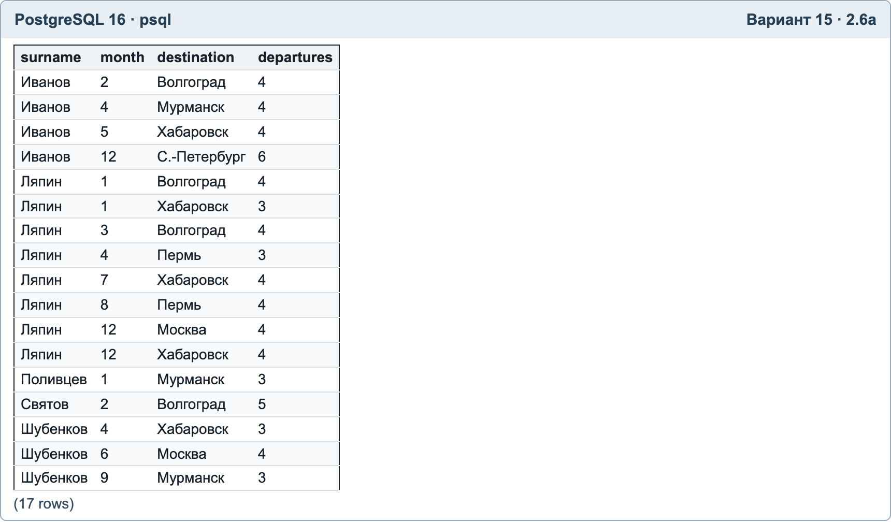

### Задание 2.6б

Для каждого рейса вывести список фамилий работавших на нём пилотов.

Список пуст для Ижевска, потому что в приложении нет полётов по этому рейсу.

```sql
SELECT r.route_id, r.destination,
       string_agg(p.surname, ', ' ORDER BY p.surname, p.pilot_id) AS pilots
FROM route AS r
LEFT JOIN (SELECT DISTINCT route_id, pilot_id FROM flight) AS assigned USING (route_id)
LEFT JOIN pilot AS p USING (pilot_id)
GROUP BY r.route_id
ORDER BY r.route_id;
```

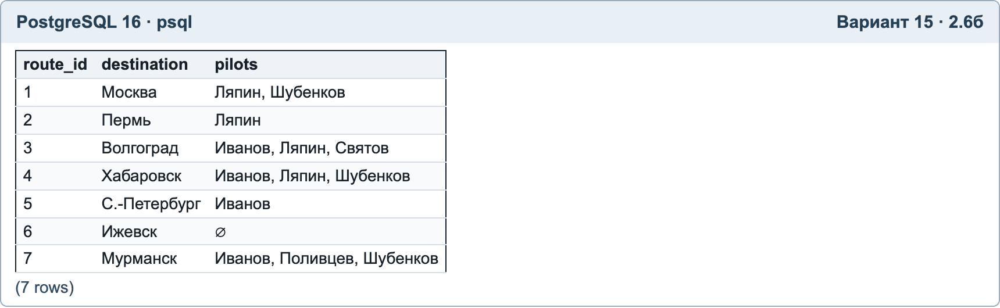

### Задание 2.6в

Определить месяцы, в которых выполнено больше трёх вылетов в Хабаровск.

```sql
SELECT f.flight_month AS month,
       SUM(f.departure_count) AS departures
FROM flight AS f
JOIN route AS r USING (route_id)
WHERE r.destination = 'Хабаровск'
GROUP BY month
HAVING SUM(f.departure_count) > 3
ORDER BY month;
```

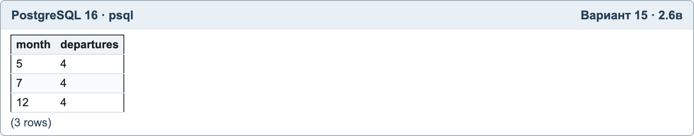

### Задание 2.6г

Определить пилотов и месяцы, в которых пилоты налетали больше 30 часов.

На исходных данных ни один пилот не превысил 30 часов за месяц после пересчёта по коэффициентам.

```sql
SELECT p.surname,
       f.flight_month AS month,
       SUM(f.flight_hours) AS total_hours
FROM flight AS f
JOIN pilot AS p USING (pilot_id)
GROUP BY p.pilot_id, month
HAVING SUM(f.flight_hours) > 30
ORDER BY p.surname, p.pilot_id, month;
```

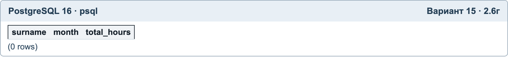

## Материалы задания

- `Л_р_ВСЕ.docx` — требования к лабораторной работе № 3 и формату защиты.
- `forLab3_задания.doc` — схема отношений и задания для варианта 15.
- `forLab3_содержимое таблиц.txt` — исходные строки для варианта 15.
- [Инструкция по запуску и SQL-файлы](README.md).
